# Stage 0 data model and boundaries

Historical Stage 0 specification. The implemented Stage 1 subset is supabase/migrations/202610200001_stage1.sql; docs/stage-1-db-contract.md and docs/status.md distinguish it from future approval/outbox/provider designs below.

Design dated 2026-10-20, America/New_York. This is a specification plus TypeScript interfaces, not a migration, database, extraction service, or working calendar integration. Stage 0 performs no external writes. Keep the proposed Next.js/TypeScript, Supabase, Trigger.dev, Resend, and Google Calendar architecture; source access findings do not justify changing it.

## Smallest durable records

One private Supabase project is sufficient. Every user-owned row has `id`, `owner_id`, and creation/update timestamps. For this single-user project, even public-source normalized records belong to the user; sharing/public catalog design is deferred. Logical records can use JSONB for bounded structured values, but relationships and uniqueness below must be database constraints in Stage 1.

| Record | Essential data and constraint |
| --- | --- |
| `organizations` | Name, official URL, affiliation evidence; no membership roster or student profiling. |
| `sources` | Organization, URL/account/native IDs, affiliation evidence, access class, enabled flag, adapter/version, expected format, credential **reference**, cadence/rate limits, cursor, cost assumptions, next due, lease, last attempt, last success, consecutive failures, operational status, verification date and proof. Registry is the initial seed; health belongs in the database. |
| `source_runs` | Source, run/attempt ID, start/end, outcome, HTTP status, request/byte/record counts, page/window bounds, pagination completeness, cursor before/proposed after, measured or unknown cost, parser version, failure reason and retry time. Failure is recorded even with zero captures. |
| `captures` | Source/run, native ID, canonical source URL, content hash, bounded private raw object or excerpt, publication/updated/first-seen/fetched timestamps, ordered media and completeness, access class, parser version, retention deadline. Unique `(owner_id, source_id, native_identity, content_sha256)`; absent native ID uses normalized source URL identity, never a made-up provider ID. Associate repeated unchanged observations with runs without duplicating the object. |
| `opportunities` | Canonical event/program/application/club/resource, ordinary title, organizations, categories, campus relation, searchable factual text, current revision/review state. Resource/club records may have no dated occurrences. Keep collection eligibility separate from recommendation score. |
| `occurrences` | Opportunity, one performance/session/trip, native instance/series keys, original start, start/end/doors values with precision and zone, venue, explicit lifecycle evidence, revision. Unique stable native instance identity **per source link**, not `(title,date)` across the campus. |
| `milestones` | Opportunity and optional occurrence; ticket release, registration opening, application close, audition, waitlist or another action; precise/unknown time, availability, link, revision. Not an occurrence date reused as an inferred sale date. |
| `field_claims` | Subject kind/ID, field, typed JSON value, evidence pointer(s), source authority by field, observed/published time, parser/model/prompt versions, candidate/selected/conflicting/superseded state. Do not erase old claims on reprocessing. |
| `source_entities` | Link native opportunity/instance/milestone identity and captures to canonical IDs; unique `(owner_id, source_id, entity_kind, native_identity)`. Explicit cross-links and canonical merges are reversible. |
| `merge_history` | From/to IDs, evidence and rule/version, actor/time, undo metadata; preserve original IDs as aliases and all decisions. No destructive merge. |
| `user_decisions` | Actor/time, canonical **occurrence or milestone** target, target revision, save/reject/preference/approve/revoke action, immutable approved display/payload snapshot, superseded decision. Append-only history; current decision projection unique `(owner_id,target_kind,target_id)`. |
| `integration_connections` | Provider/account identity, encrypted token reference, scopes, app-created calendar ID, health/revocation state. Tokens never in client JSON, capture logs, repo, or model input. |
| `outbox` | Channel/command, decision FK for calendar actions, immutable snapshot/hash, durable action key, provider event ID, lease, attempts/backoff, result/error. Unique action key, composite ownership FKs, and valid decision/action checks. Alerts use a distinct command namespace and the user's delivery preferences. |
| `calendar_links` | Owner + connection + target, Google calendar/event IDs, last approved decision/payload, provider etag, write status, manual-edit/deletion tombstone. Unique `(owner_id,connection_id,target_kind,target_id)` and `(connection_id,provider_event_id)`. |
| `delivery_ledger` | Outbox/attempt, provider delivery ID, accepted/delivered/bounced/failed timestamps, webhook event dedupe key. Provider acceptance and confirmed delivery are different facts. |

`field_claims` uses a subject-kind check plus separate nullable opportunity/occurrence/milestone FKs with exactly one present (or three subject-specific link tables). Avoid an unchecked polymorphic ID. Composite `(id,owner_id)` FKs on every relationship prevent linking another owner's capture or decision. Store recurrence rules/exceptions in bounded JSON on opportunity/series data; materialize only a bounded horizon of occurrences and preserve each instance's original identity.

Registry seed mapping is explicit: `cadence_minutes * 60` becomes `cadenceSeconds`; a disabled or manual route has null cadence and next-due time. Preserve registry statuses verbatim, including `documented_but_untested`; a successful page retrieval alone does not promote the status. Date-only registry verification metadata remains date-only evidence until a timestamped run provides a real instant.

## Evidence and time semantics

`contracts/adapter.ts` specifies boundary types; Stage 1 must add runtime validation and SQL constraints. A claim needs an existing capture plus a text span, JSON pointer, ordered slide/region, or video timestamp. Retain field claims for important facts including title, start/end, doors, location, price, eligibility, availability and action deadlines. User corrections have their own actor/time provenance. Missing values stay null; neither valid JSON nor a model confidence percentage proves truth.

Time is `instant`, `date`, or `unknown`, with source local text and IANA zone. Preserve publication, first-seen, fetch, doors, event, sale and application times separately. Convert exact local times through the zone; reject nonexistent local times and request clarification for ambiguous DST folds. A date-only deadline has no implicit 23:59 time. A missing year, ambiguous midnight, reused flyer or conflicting year requires verification. Relative dates use a reliable original publication context, never fetch time; with no publication context they remain unknown.

MatPat regression: the live official listing was checked on 2026-10-20 and shows a September 29, 2026 evening occurrence plus a March 4 ticket reference. Keep separate evidence and an unresolved ticket-time claim. The event's existence now proves neither its first announcement nor a verified ticket release. `evaluation/cases.json` links the live reference and labels all invented scenarios as synthetic.

An approved timed calendar event needs an end because Google requires start and end. If the source lacks an end, show a proposed duration and obtain the user's explicit confirmation; preserve `user_confirmed_estimate` and label it in the calendar description. Location may remain unconfirmed. A date-only action may be an explicitly approved all-day reminder, with the exclusive next-day end date. Unknown or conflicting start/date blocks synchronization until reviewed.

## Collection and matching rules

1. Lease one due source using a database transaction; use per-platform concurrency/cost limits. A read-only collector returns captures and health evidence, not recommendations or side effects.
2. Detect access/error payloads independently of HTTP status. A login wall with HTTP 200 is blocked. Pagination gaps, missing carousel slides or truncated results are partial. `not_modified` references a prior validated run and says nothing about unvisited pages. Never label these as successful empty collection.
3. Persist raw objects, capture metadata and run associations before advancing the cursor in the same database transaction. Partial captures may be saved but do not advance a global cursor past an uncollected region. Retries overlap windows and use hashes/native IDs to deduplicate. Keep last attempt separate from last success.
4. Extract zero or more opportunities, occurrences and milestones. Every carousel slide must be accounted for. Partial media creates a visible issue and cannot qualify as fully processed extraction. Irrelevant input is a valid zero-opportunity result.
5. Match by stable source/native instance IDs and explicit cross-links first. Generate conservative candidates with organizer, normalized title, instance date/time, venue, ticket URL and poster hash. A shared title, host or poster alone is insufficient. Same show on different evenings remains separate occurrences; different organizations' GBMs remain different opportunities. Date shifts match through stable instance IDs or reviewed change evidence, never by overwriting unrelated performances.
6. Select fields using field-specific authority, source recency and context. Organizer statements usually control venue/cancellation; ticketing controls inventory. New third-party speculation does not override an organizer. Keep contradictory claims visible. Disappearance is not cancellation; affirmative evidence is required.
7. Reversible merge maps aliases to one target and reconciles decisions under a lock. An existing rejection follows canonical duplicates. A merge must not create an extra outbox action; two already approved calendar entries require explicit reconciliation, not automatic deletion. A material reschedule may reappear for review with explanation.
8. Store and index the full private catalog with Postgres text search. Recommendation scores/lanes are separate from collection acceptance; routine events can rank low without hiding the source. An occurrence rejection does not become a category or club rejection. Keep an exploration lane and campus-first context.

## Approval and outbox transaction

```mermaid
flowchart LR
  A[Read-only capture and run] --> B[Claims and unresolved conflicts]
  B --> C[Canonical opportunity / occurrence / milestone]
  C --> D[Private searchable review inbox]
  D --> E[Explicit approval of one target and shown facts]
  E --> F[One DB transaction: decision + outbox]
  F --> G[Leased worker verifies approval + snapshot]
  G --> H[Idempotent provider write and calendar link]
  H --> I[Reconcile uncertain result / manual edits]
```

The approval endpoint authenticates the user, checks target ownership, locks the target/current decision, and compares the shown revision/hash to the current facts. Stale revisions return a review conflict. Inside **one** transaction it inserts an append-only decision with the exact accepted timing/content, updates the current-decision projection, and inserts the outbox command with a durable unique action key. Repeated requests with the same client approval key return the existing result. Save, digest/alert delivery and RSVP are not approval. No whole-series, whole-club or wildcard approval.

Use a stable target calendar-link identity and a UUID-derived lowercase hexadecimal Google event ID (32 hex characters meet the documented character/length rules). Persist it before any provider call. The per-action key additionally distinguishes create/update/delete and approval revision; retries never allocate a new event ID. Do not derive provider identity from a mutable title/time. A create for a new revision uses the existing calendar link instead of a second event.

The worker leases with `FOR UPDATE SKIP LOCKED`, checks the latest effective decision, snapshot hash, connection state, ownership and absence of tombstone, then sends the approved payload. Mark success and link IDs transactionally after the network result. A timeout after Google may have accepted the insert is **uncertain**, not a failed event: GET the persisted ID and compare private app/target metadata and payload before deciding whether to insert/retry. An existing conflicting ID is a conflict requiring review, never permission to overwrite an unrelated event. Exactly-once execution is not promised; durable idempotency and reconciliation aim for one calendar effect.

Revocation stops pending work under the same target lock; undo of an already written item is a separate user-authorized delete command. A revocation racing an in-flight request can require a compensating delete; keep pending state visible until reconciliation. Token revocation needs reauthentication without losing approval/outbox state. A manually deleted event gets a tombstone and is not recreated on the next retry. Manual edits cause a visible conflict; conditional writes using the last etag avoid silently clobbering them. A source change or cancellation triggers a review/alert, never an unapproved calendar rewrite. For Stage 1, calendar commands remain disabled; later stages must run the failure suite against a separate test calendar before enabling writes.

## Ownership, privacy and untrusted content

Enable RLS on every exposed user table; grant the authenticated owner read access with `owner_id = auth.uid()`, check ownership on inserts/updates, and deny anonymous access. Restrict mutation of claims, run health, outbox, connections and delivery records to bounded server routines; the browser cannot forge approval or mark a job delivered. Test both row ownership and cross-owner relationships. Keep secrets in server-only encrypted storage. Service-role jobs bypass RLS, so their input checks, composite FKs, explicit owner filters and audit records remain necessary. Use a dedicated job role with narrower grants where feasible.

Private Supabase Storage buckets use owner-prefixed object paths, authenticated/signed reads and storage RLS. Capture retention is a **proposed** default of 30 days for public raw content, 90 days for minimized public evidence excerpts, and 7 days for permitted ephemeral/private intake unless explicitly saved and permitted. Retain other decision evidence longer only under an explicit policy. Unknown permission or retention requirements block capture. Never put private raw evidence in public assets, Git fixtures or telemetry. Strip newsletter tracking links/unneeded addresses. Purge raw media on expiry and retain a deletion marker; immutable hashes do not justify retaining personal content forever. Stage 1 must verify database backup/restore and delete semantics.

Treat retrieved documents as data, not instructions. Extraction runs without calendar/email/purchase credentials or tools. Intake URLs need public-host allowlists or carefully validated egress, redirect checks, DNS/IP revalidation, byte/time limits and private-network blocking. Signed inbound/webhook verification, replay dedupe, upload size/type limits and HTML sanitization are required before accepting public intake. No FSU password storage, organizer contact, RSVP or purchasing path is part of Stage 0.

## Primary references checked 2026-10-20

- [Supabase RLS](https://supabase.com/docs/guides/database/postgres/row-level-security) and [Storage access control](https://supabase.com/docs/guides/storage/security/access-control): database and object authorization boundaries.
- [Google event insertion](https://developers.google.com/workspace/calendar/api/v3/reference/events/insert): required start/end, supported scope, event-ID rules, private metadata and recurrence identity.
- [Google error handling](https://developers.google.com/workspace/calendar/api/guides/errors): auth/rate failures, duplicate IDs, stale etags and expired sync state.
- [Google OAuth consent/scopes](https://developers.google.com/workspace/guides/configure-oauth-consent): choose minimum scopes and configure consent; `calendar.app.created` is the proposed first write scope, optional free/busy access is separate.
- [Official MatPat listing](https://calendar.fsu.edu/event/golden-torch-lecture-series-presents-an-evening-with-matpat): present-day conflict reference only.
